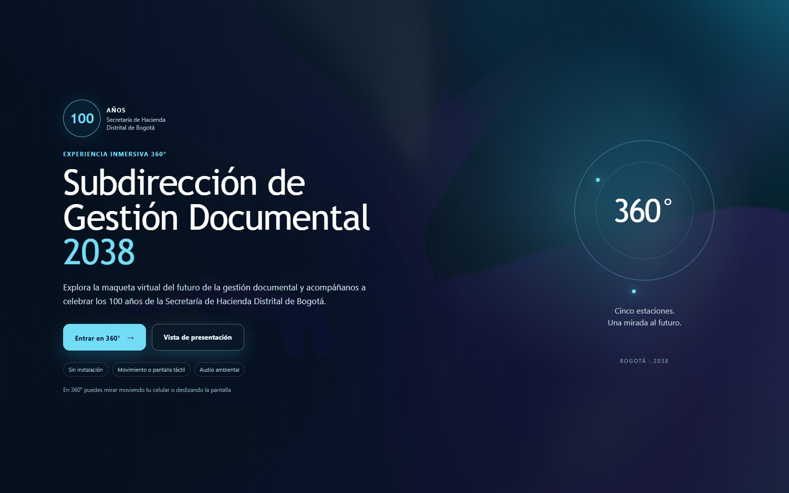
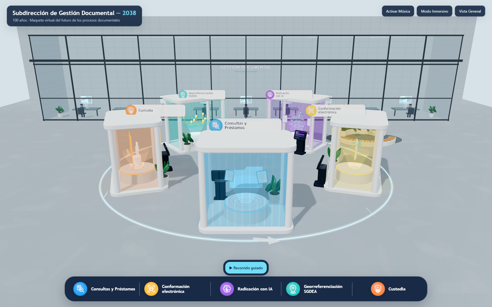

# Sala 360 — Subdirección de Gestión Documental

Experiencia virtual 360° sobre el futuro de la gestión documental de la Secretaría de Hacienda Distrital de Bogotá.



## Estado del proyecto

- Publicado en GitHub Pages.
- Sitio estático, sin servidor de aplicaciones ni base de datos.
- Three.js incluido dentro del archivo principal.
- Adaptado para escritorio, transmisión por Teams y celulares compatibles.
- Música de fondo incluida y documentada.

## Acceso

| Recurso | Dirección |
|---|---|
| Experiencia | https://pruebadedireccion.github.io/sala-360-gestion-documental/ |
| Pantalla con QR | https://pruebadedireccion.github.io/sala-360-gestion-documental/qr.html |
| QR para materiales | https://pruebadedireccion.github.io/sala-360-gestion-documental/qr.png |

## Características

- Recorrido circular por cinco estaciones de gestión documental.
- Vista de presentación con cámara elevada y recorrido guiado.
- Modo 360° con punto de observación fijo.
- Control por movimiento del dispositivo o navegación táctil.
- Control de sonido y música de fondo en bucle.
- Paneles informativos con una frase de impacto por proceso.
- Oficinas de fondo con personal estilizado y paneles holográficos.
- Código QR de acceso para transmisiones por Teams.
- Portada cinematográfica con transición audiovisual de 8 segundos.
- Interfaz responsiva para escritorio y móvil.



## Modos de uso

### Vista de presentación

Pensada para compartir pantalla durante una transmisión. Mantiene una composición general de la sala y permite activar el recorrido automático por las cinco estaciones.

### Entrar en 360°

Ubica al visitante en un punto fijo, a altura humana, y le permite mirar alrededor moviendo el celular. Si los sensores no están disponibles, la pantalla puede explorarse con gestos táctiles.

Al seleccionar este modo se reproduce una transición audiovisual de 8 segundos, sin sonido y con opción de saltarla. Si el dispositivo prefiere movimiento reducido, la transición se omite y se entra directamente a la experiencia.

El uso de sensores requiere que el sitio se abra mediante HTTPS y que el usuario autorice el acceso cuando el navegador lo solicite.

## Estaciones

| N.º | Estación | Enfoque |
|---|---|---|
| 1 | Consultas y Préstamos | Acceso inmediato al expediente y acompañamiento al ciudadano. |
| 2 | Conformación electrónica | Integración de documentos dispersos en un expediente electrónico. |
| 3 | Radicación con IA | Clasificación, priorización y enrutamiento inteligente. |
| 4 | Georreferenciación SGDEA | Contexto físico y territorial de cada expediente. |
| 5 | Custodia | Preservación física y digital con trazabilidad. |

## Controles

- Arrastrar con el mouse o deslizar en pantalla: rotar la vista.
- Rueda del mouse o pellizco: acercar o alejar.
- Clic o toque sobre una estación: seleccionarla.
- Botón **Recorrido guiado**: iniciar la visita automática.
- Botón **Activar/Desactivar Música**: controlar el audio de fondo.
- Botón **Modo Inmersivo**: ocultar la interfaz.
- Botón **Recentrar**: recuperar la orientación inicial en modo 360°.

### Atajos de teclado

| Tecla | Acción |
|---|---|
| `1` a `5` | Abrir una estación |
| `T` | Iniciar, pausar o reanudar el recorrido |
| `N` | Avanzar a la siguiente estación durante el recorrido |
| `I` | Activar o desactivar el modo inmersivo |
| Flechas | Rotar la vista |
| `Esc` | Detener recorrido, salir del modo 360° o regresar a la vista general |

## Requisitos

- Navegador actualizado con soporte para WebGL.
- Chrome o Edge en escritorio para la presentación.
- Android con Chrome o iPhone con Safari para probar el modo 360°.
- Conexión HTTPS para acceder a los sensores de orientación.
- Audio del dispositivo activo para escuchar la música de fondo.

## Estructura del repositorio

```text
.
├── index.html              Aplicación completa y distribución principal
├── qr.html                 Pantalla de acceso con QR para Teams
├── qr.png                  QR listo para PowerPoint y materiales impresos
├── qr.svg                  Versión vectorial del QR
├── audio/
│   └── future-design.mp3   Música de fondo
├── video/
│   ├── tunnel-360.mp4      Transición de entrada de 8 segundos
│   └── tunnel-360-poster.jpg  Imagen de respaldo del video
├── docs/
│   ├── preview-inicio.jpg  Imagen de la portada
│   ├── preview.png         Imagen de vista general
│   ├── OPERACION.md        Guía de operación del evento
│   └── ARQUITECTURA.md     Descripción técnica
├── CREDITS.md              Créditos y licencias de terceros
├── CONTRIBUTING.md         Flujo de cambios y validación
├── CHANGELOG.md            Historial de versiones
├── README.md
├── .editorconfig
├── .gitattributes
├── .gitignore
└── .nojekyll               Evita el procesamiento de Jekyll en GitHub Pages
```

## Ejecución local

No se requiere instalación de dependencias ni proceso de compilación.

Desde la raíz del repositorio:

```powershell
python -m http.server 8000
```

Luego abrir:

```text
http://localhost:8000/
```

También se puede usar cualquier servidor HTTP estático. No se recomienda abrir `index.html` directamente con `file://`, porque la carga de la música y el comportamiento de algunas APIs del navegador pueden variar.

## Publicación

El sitio se publica desde GitHub Pages usando la rama `main` y la raíz del repositorio.

Configuración:

1. Abrir **Settings → Pages** en el repositorio.
2. Seleccionar **Deploy from a branch**.
3. Elegir la rama `main`.
4. Seleccionar la carpeta `/ (root)`.
5. Guardar los cambios.

El archivo `.nojekyll` evita que GitHub Pages procese el sitio con Jekyll.

## Actualización

1. Modificar `index.html` o los recursos correspondientes.
2. Ejecutar una prueba local.
3. Revisar la lista de validación de [CONTRIBUTING.md](CONTRIBUTING.md).
4. Registrar el cambio en [CHANGELOG.md](CHANGELOG.md).
5. Publicar los cambios:

```powershell
git add .
git commit -m "Descripción del cambio"
git push
```

GitHub Pages publicará automáticamente la nueva versión.

## Pruebas recomendadas

Antes de una presentación o evento:

- Abrir la experiencia en escritorio.
- Ejecutar el recorrido guiado completo.
- Probar cada estación y sus paneles.
- Verificar la música y el control de silencio.
- Abrir el modo 360° en un celular real.
- Probar el permiso de movimiento concedido y rechazado.
- Comprobar el modo táctil.
- Escanear el QR desde otro dispositivo.
- Probar la pantalla del QR dentro de una transmisión de Teams.
- Verificar la página en móvil y en horizontal.

La guía operativa completa está en [docs/OPERACION.md](docs/OPERACION.md).

## Privacidad y accesibilidad

- La experiencia no solicita acceso a cámara ni micrófono.
- No existe backend ni recolección de datos personales.
- No se utiliza analítica de terceros.
- El control por movimiento es opcional.
- Existe alternativa táctil para navegar.
- Se respeta la preferencia del sistema de movimiento reducido.
- Los controles principales son accesibles por teclado.

## Créditos y licencias

La música y las bibliotecas de terceros se documentan en [CREDITS.md](CREDITS.md).

El contenido institucional debe utilizarse de acuerdo con las políticas de la Secretaría de Hacienda Distrital de Bogotá. Los componentes de terceros conservan sus propias licencias.
